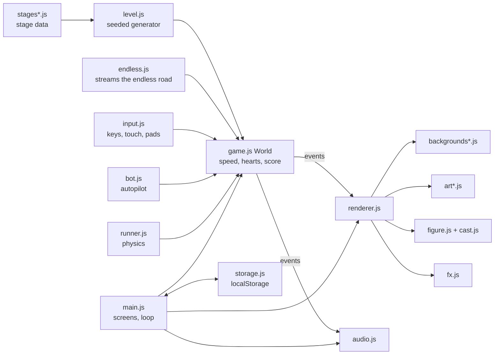

# The Long Run Home Technical Design

## Stack
- **JavaScript ES modules, no build step, no dependencies**: the browser loads `src/*.js` as is, so
  there is nothing to install or bundle and nothing in a supply chain.
- **Canvas 2D** for all drawing: every background, prop and runner is painted in code, no images.
- **Web Audio** for all sound: footsteps, ambiences and music are synthesized, no audio files.
- **localStorage** for progress and settings: the only storage there is.
- **Node 22 `node:test`** for tests, with no test framework to install.
- **GitHub Pages**, deployed by GitHub Actions: free static hosting, published only after tests pass.
- LLM model: N/A, the game uses none.

## Architecture

- A stage is data (`src/stages*.js`): palette, terrain, weather, music, prop skins and pattern
  weights. `level.js` turns it into a level with a seeded RNG, so a stage is identical on every play.
- Each group of stages has its own art trio: `stages-X.js`, `backgrounds-X.js` (parallax layers
  painted once, plus moving parts drawn each frame) and `art-X.js` (ground, pits, props, rollers,
  swings, drops, decor, finale). `art.js` and `backgrounds.js` try each trio in turn.
- `game.js` (World) is renderer-agnostic and emits events; the same World runs headless in tests.
- `CHAPTERS` in `stages.js` is built from each chapter's own stage list.

## Data model
One localStorage key, `long-run-home.v1`, holding JSON:

| Field | What | Personal? |
|---|---|---|
| `order` | stage ids in the order the arrays below use | no |
| `progress.kids` / `progress.adult` | `unlocked` (count), `stars[]`, `coins[]`, `endlessBest`, `endlessCoins` | no |
| `settings.runner`, `team`, `diff`, `muted` | who runs, difficulty, sound | no |
| `settings.names` | names the player typed for cast runners (16 characters max) | **possibly**, if a player types a real name. It stays on the device. |

Saves from before stages were inserted mid-game have no `order`; `storage.js` maps them onto
stages by id, so stars stay with the right stages.

## APIs / tools
N/A: no server and no network API. Debug hooks in the page:
- `?unlock=all` in the address opens every stage and the endless road on both difficulties and
  keeps stars (`applyUnlock` in `storage.js`).
- `window.__game` exposes `startStage(i)`, `openMap()` and the store, for screenshots and testing.

## Agent design (if LLM)
N/A: the "autopilot" (`bot.js`) is a deterministic search, not an LLM. It simulates candidate
button presses with the player's own physics and picks a safe one.

## Testing
`npm test` runs `node --test tests/*.test.js`, currently 126 tests:
- `autopilot.test.js`: every stage on both difficulties, finished with zero hits and zero falls.
- `level.test.js`: determinism, every gap within jump reach, kids levels gentler (under 0.85 of the
  adult hazard rate), every stage names only props, terrains and chapters that exist.
- `endless.test.js`: determinism, the leg cycle, flat memory, and the autopilot driving the whole road.
- `runner.test.js`: jump heights, slide clearance, landing on and bumping into obstacles.
- `cast.test.js`: the roster, save migration (including stages inserted mid-game), and `?unlock=all`.

Art is checked by eye: headless Chromium renders a gallery of every prop and each stage in play.

## Deployment
- `.github/workflows/pages.yml`: on every push and pull request runs `npm test`; on `main` only, and
  only after tests pass, copies `index.html`, `privacy.html`, `terms.html`, `css/` and `src/` into a Pages artifact and deploys it.
- Live at https://tanilancc.github.io/stickgirlrun/
- Environment variables: none. Secrets: none (deploys use the workflow's own short-lived token).
